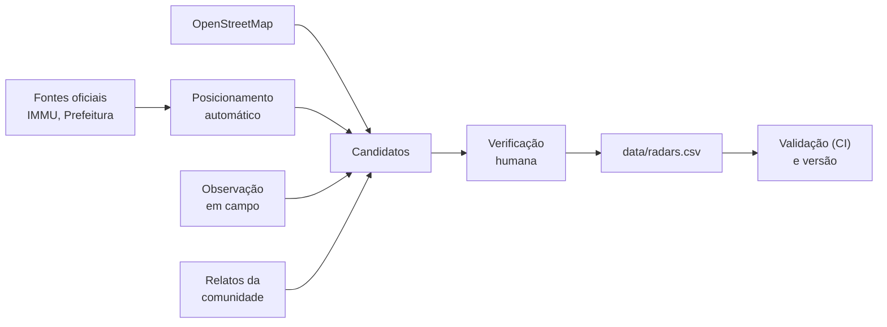

<h1 align="center">open-radars-manaus</h1>

  Equipamentos fixos de fiscalização eletrônica de trânsito em Manaus (AM): dados abertos e verificados.
   
  <em>Fixed traffic-enforcement devices in Manaus, Brazil: open, human-verified data.</em>

  
  
  
  

  <a href="#o-que-é">O que é</a> ·
  <a href="#como-os-dados-são-produzidos">Método</a> ·
  <a href="#baixar">Baixar</a> ·
  <a href="#formato-dos-dados">Formato</a> ·
  <a href="#contribuições-são-bem-vindas">Contribuir</a> ·
  <a href="#english">English</a>

---

**Status:** early

> [!NOTE]
> **Estado atual:** a versão `2026.11.0` é o ponto de partida do projeto, com um único ponto verificado.
> Ela ainda não cobre a cidade. Os candidatos gerados a partir das fontes oficiais estão em verificação;
> `data/radars.csv` recebe só os pontos já verificados. Detalhes em
> [Metodologia § 8](docs/methodology.md#8-estado-atual).

## O que é

Um registro aberto dos **equipamentos fixos de fiscalização eletrônica** em Manaus, com posição,
sentido de tráfego fiscalizado, limite de velocidade e data da última verificação por uma pessoa.

| `kind` | Equipamento |
|--------|-------------|
| `speed` | Medidor de velocidade fixo (radar fixo). Um equipamento que também fiscaliza avanço de sinal conta como `speed`. |
| `bump` | Lombada eletrônica: medidor de velocidade fixo do tipo redutor, que mostra a velocidade ao condutor. |
| `redlight` | Fiscalização de avanço de sinal vermelho, sem medição de velocidade. |

Só entram equipamentos **fixos** em via pública. Os dados servem a quem quiser usá-los (um mapa, um
aplicativo, um estudo); o uso fica a critério de cada um.

## Como os dados são produzidos

1. **Fontes.** As fontes oficiais dão endereços e sentidos cardeais, sem coordenadas.
2. **Candidatos.** Cada endereço é posicionado automaticamente sobre a rede viária do OpenStreetMap: no
   cruzamento das duas vias ou no trecho da via, na pista do sentido informado. Observações em campo e
   relatos também entram como candidatos.
3. **Verificação.** Uma pessoa confere cada candidato no mapa de revisão, ajusta posição e sentido e
   confirma. Só pontos confirmados entram no CSV, com a data da confirmação.
4. **Validação e publicação.** A integração contínua valida cada mudança; as versões são publicadas como
   releases.

O método completo, com parâmetros, fontes de erro e limitações, está em
**[docs/methodology.md](docs/methodology.md)**.

## Baixar

| Formato | Versão mais recente |
|---------|---------------------|
| CSV | [`radars.csv`](https://github.com/jvitorcosta/open-radars-manaus/releases/latest/download/radars.csv) |
| GeoJSON | [`radars.geojson`](https://github.com/jvitorcosta/open-radars-manaus/releases/latest/download/radars.geojson) |

As versões seguem o calendário (`AAAA.MM.N`, por
exemplo `2026.11.0`), então dá para fixar uma; o que mudou em cada uma está no
[CHANGELOG](CHANGELOG.md).

## Formato dos dados

`data/radars.csv` é a fonte da verdade: UTF-8, quebra de linha LF, sem aspas, linhas em ordem de `id`.
`data/radars.geojson` é gerado a partir dele e nunca é editado à mão.

| Coluna | Tipo | Significado |
|--------|------|-------------|
| `id` | texto | `mao-NNNN`, atribuído em ordem e nunca reutilizado |
| `kind` | texto | `speed`, `bump` ou `redlight` |
| `lat`, `lon` | graus | WGS84, 6 casas decimais, sobre a pista do sentido fiscalizado |
| `heading` | graus | 0 a 359, azimute do sentido fiscalizado a partir do norte verdadeiro. Obrigatório |
| `limit` | km/h | 1 a 199; vazio quando desconhecido; sempre vazio em `redlight` |
| `label` | texto | `Via · Bairro`, por exemplo `Av. Prof. Nilton Lins 900 · Flores`. Sem vírgulas nem aspas |
| `source` | texto | origem do ponto: `immu`, `survey`, `osm`, `car` ou `community` ([definições](docs/methodology.md#4-fontes)) |
| `checked` | data | AAAA-MM-DD da verificação mais recente por uma pessoa. Obrigatório |

Um ponto por sentido: um equipamento que fiscaliza os dois sentidos ocupa duas linhas, com `heading`
opostos. Ids removidos ficam em `data/retired.txt`.

## Contribuições são bem-vindas

| Como | Para quê |
|------|----------|
| [Informar um radar](https://github.com/jvitorcosta/open-radars-manaus/issues/new?template=informar-radar.yml) | Um equipamento que não está na lista. Não precisa saber git. |
| [Algo errado](https://github.com/jvitorcosta/open-radars-manaus/issues/new?template=algo-errado.yml) | Um ponto que mudou de lugar, não existe mais ou tem limite ou sentido errado. |
| Pull request | Editar `data/radars.csv` diretamente; o passo a passo está no [CONTRIBUTING](CONTRIBUTING.md). |

Toda mudança é conferida pela integração contínua e revisada pelo mantenedor, que faz o merge.

## Regras

- Só equipamentos **fixos** em via pública. Blitz, barreiras policiais e radares móveis não entram.
- Sem dados pessoais: fotos sem placas nem rostos, e nenhum trajeto de GPS publicado.
- Só pontos verificados entram no CSV. Candidatos ficam fora.

## Licenças e citação

- **Dados** (`data/`): [ODbL 1.0](data/LICENSE). Parte da rede viária usada no posicionamento vem do
  OpenStreetMap: © OpenStreetMap contributors.
- **Código** (`tools/`, testes e CI): [MIT](LICENSE).
- Para citar, use o botão *Cite this repository* do GitHub ([CITATION.cff](CITATION.cff)) e informe a
  versão usada.

## Nota legal

Este repositório lista a localização de infraestrutura pública de fiscalização. Não detecta nem emite
sinal algum e não é um detector de radar, equipamento proibido pelo Código de Trânsito Brasileiro
(art. 230, III). Isto é informação, não aconselhamento jurídico.

---

## English

> [!NOTE]
> **Status:** release `2026.11.0` is the project's kickoff, with a single verified point; it does not
> cover the city yet. Candidates generated from the official sources are being verified;
> `data/radars.csv` only receives verified points. See [Methodology § 8](docs/methodology.md#8-current-status).

### What it is

An open record of the **fixed electronic traffic-enforcement devices** in Manaus, Brazil: position,
enforced direction of travel, speed limit and the date a person last verified each one. Kinds: `speed`
(fixed speed camera; one that also enforces red lights counts as `speed`), `bump` (*lombada eletrônica*,
a fixed speed meter that shows drivers their speed) and `redlight` (red-light camera without speed
measurement). Fixed devices on public roads only; how you use the data is up to you.

### How the data is produced

Official sources give street addresses and cardinal directions, not coordinates. Each address is placed
automatically on the OpenStreetMap road network (at the junction of the two roads, or on the named road,
on the carriageway of the stated direction), producing a **candidate**. Field observations and community
reports are candidates too. A person checks each candidate on the review map, adjusts it and confirms
it; only confirmed points enter the CSV, dated. CI validates every change, and versions are released.
The full method, with parameters, error sources and limitations, is in
**[docs/methodology.md](docs/methodology.md#methodology)**.

### Download

[`radars.csv`](https://github.com/jvitorcosta/open-radars-manaus/releases/latest/download/radars.csv) ·
[`radars.geojson`](https://github.com/jvitorcosta/open-radars-manaus/releases/latest/download/radars.geojson)
Calendar versions (`YYYY.MM.N`) can be pinned; changes are in the
[CHANGELOG](CHANGELOG.md).

### Data format

`data/radars.csv` is the source of truth (UTF-8, LF, no quoting, sorted by `id`); `data/radars.geojson`
is generated from it. Columns: `id` (`mao-NNNN`, never reused), `kind`, `lat`/`lon` (WGS84, 6 decimals,
on the enforced carriageway), `heading` (0–359, azimuth of the enforced direction from true north,
required), `limit` (km/h or empty; always empty for `redlight`), `label` (`Road · District`), `source`
(`immu`, `survey`, `osm`, `car`, `community`) and `checked` (date of the latest human verification). One
row per direction; removed ids are listed in `data/retired.txt`.

### Contributing

Open an issue with a form (*Informar um radar* to report a device, *Algo errado* to correct one; no git
needed), or send a pull request following [CONTRIBUTING.md](CONTRIBUTING.md). CI checks every change and
the maintainer reviews and merges.

### Ground rules

Fixed public devices only (no police checkpoints or mobile radars); no personal data (no plates, faces
or GPS tracks); verified points only.

### Licences and citation

Data: [ODbL 1.0](data/LICENSE), © OpenStreetMap contributors for the road network used in placement.
Code: [MIT](LICENSE). To cite, use GitHub's *Cite this repository* ([CITATION.cff](CITATION.cff)) and
state the version.

### Legal note

This repository lists the location of public enforcement infrastructure. It senses and emits nothing and
is not a radar detector, which Brazil's traffic code bans (CTB art. 230, III). This is information, not
legal advice.
