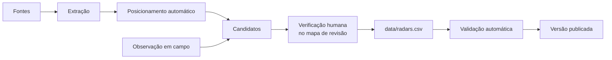

# Metodologia

Como os dados de `open-radars-manaus` são coletados, posicionados, verificados e publicados.
[English version below](#methodology).

Este documento descreve o processo como ele está implementado em `tools/`. Quando o código muda, este
texto muda no mesmo pull request. Parâmetros numéricos são citados com o nome da constante no código,
para que cada valor possa ser conferido.

## Sumário

1. [Objetivo e escopo](#1-objetivo-e-escopo)
2. [Definições](#2-definições)
3. [Unidade de registro](#3-unidade-de-registro)
4. [Fontes](#4-fontes)
5. [Processamento](#5-processamento)
6. [Qualidade e incerteza](#6-qualidade-e-incerteza)
7. [Limitações conhecidas](#7-limitações-conhecidas)
8. [Estado atual](#8-estado-atual)
9. [Reprodutibilidade](#9-reprodutibilidade)
10. [Privacidade e ética](#10-privacidade-e-ética)
11. [Referências](#11-referências)

## 1. Objetivo e escopo

Produzir um registro aberto, verificado por pessoas, dos **equipamentos fixos de fiscalização eletrônica
de trânsito** no município de Manaus (AM): posição, sentido de tráfego fiscalizado, limite de velocidade
e data da última verificação.

**Dentro do escopo:** equipamentos fixos em via pública dos três tipos definidos na seção 2.

**Fora do escopo:** fiscalização móvel, estática ou portátil; operações policiais; detectores de eixo e
outros equipamentos que não fiscalizam velocidade nem avanço de sinal; qualquer local fora do retângulo
envolvente de Manaus (`-3.25, -60.15` a `-2.90, -59.80`).

## 2. Definições

| Termo | Definição neste repositório |
|-------|-----------------------------|
| Equipamento | O dispositivo físico de fiscalização instalado na via. |
| Ponto | Uma linha de `data/radars.csv`: um equipamento **em um sentido de tráfego**. Um equipamento que fiscaliza os dois sentidos gera dois pontos. |
| `speed` | Medidor de velocidade fixo ("radar fixo"). Um equipamento que fiscaliza velocidade e avanço de sinal é classificado como `speed`. |
| `bump` | Medidor de velocidade fixo do tipo redutor, conhecido como lombada eletrônica: exibe a velocidade medida ao condutor. |
| `redlight` | Equipamento de fiscalização de avanço de sinal vermelho (CTB, art. 208), sem medição de velocidade. |
| Sentido fiscalizado (`heading`) | Azimute do deslocamento dos veículos fiscalizados, em graus inteiros de 0 a 359, medido no sentido horário a partir do norte verdadeiro. |
| Sentido cardeal | O sentido como as fontes oficiais o publicam (`Norte`, `Leste`, `Sul`, `Oeste`), convertido em 0, 90, 180 e 270. |
| Candidato | Uma posição proposta, automática ou vinda de campo, que ainda não foi verificada. Candidatos nunca entram em `data/radars.csv`. |
| Verificação | O ato de uma pessoa confirmar, no mapa de revisão ou na via, a posição e o sentido de um ponto. Registrada na coluna `checked`. |
| Mapa de revisão | Página local (`tools/review_map.html`) em que candidatos são conferidos, ajustados e confirmados. |

## 3. Unidade de registro

Cada ponto tem as colunas `id,kind,lat,lon,heading,limit,label,source,checked`, descritas no
[README](../README.md#formato-dos-dados). Observações de método:

- `lat` e `lon` são coordenadas WGS84 com 6 casas decimais (resolução de cerca de 0,1 m). A resolução
  do arquivo não é a exatidão da posição; ver a seção 6.
- A posição fica sobre a pista do sentido fiscalizado, no local do equipamento ou, em cruzamentos, antes
  da linha de retenção.
- `source` registra a **origem do ponto** (a primeira fonte que o indicou) e não muda quando o ponto é
  verificado.
- `checked` registra a data da **verificação mais recente** por uma pessoa.

## 4. Fontes

| Fonte | Tipo | O que fornece | O que não fornece | `source` |
|-------|------|---------------|-------------------|----------|
| Página "Consulta Aferição dos Radares" do IMMU | Oficial (primária) | Tipo, endereço em texto, sentido cardeal | Coordenadas, limite de velocidade | `immu` |
| Notas da Prefeitura de Manaus e da imprensa sobre novos equipamentos, transcritas em `tools/lists/` | Oficial e imprensa | Tipo, endereço ou cruzamento, sentido cardeal, às vezes o limite | Coordenadas | `immu` |
| Levantamentos Técnicos do IMMU (Av. do Turismo) | Oficial (primária) | Endereço, sentido, limite (60 km/h, dos PDFs) | Coordenadas | `survey` |
| OpenStreetMap: nós `highway=speed_camera` | Colaborativa (ODbL) | Coordenadas; às vezes `maxspeed` e `direction` | Garantia de que o equipamento existe hoje | `osm` |
| Observação em campo a partir de um veículo | Observação direta | Coordenadas GNSS e rumo no momento da marcação | Tipo e limite (anotados na revisão) | `car` |
| Relatos pelos formulários de issue | Comunidade | Endereço ou link de mapa, sentido, limite, data | Coordenadas verificadas | `community` |

Detalhes por fonte:

- **IMMU.** A página é lida por `tools/sources.py` (`IMMU_URL`). Os três blocos da página (radares de
  velocidade, lombadas, radares de avanço) definem o `kind`. O texto do sentido é convertido pelo mapa
  `_SENTIDO`; um sentido que não seja um ponto cardeal (por exemplo "sentido bairro") fica sem azimute.
- **Anúncios.** Cada arquivo em `tools/lists/` é uma transcrição manual de um anúncio, com a lista das
  fontes em [`tools/lists/README.md`](../tools/lists/README.md). A transcrição mantém a grafia das ruas
  como publicada e registra divergências na coluna `note`. Itens já presentes em outra fonte e itens fora
  do escopo (detectores de eixo) não são transcritos.
- **OpenStreetMap.** Consulta Overpass por nós `highway=speed_camera` no retângulo envolvente. Um nó do
  OSM é tratado como candidato como qualquer outro: a existência do equipamento não é presumida.
- **Observação em campo.** Duas formas de registro, ambas gerando candidatos:
  1. O CarDeck (projeto do mantenedor) registra a posição e o rumo GNSS recebidos do telefone no instante
     da marcação e os envia a um repositório **privado**; `place --from marks` os lê.
  2. Um relógio GNSS gravando uma atividade, com o botão Lap pressionado ao passar pelo equipamento.
     Cada volta, exceto a última (que termina no Stop), marca um ponto no índice final da volta
     (`end_index`) do trajeto. O rumo é calculado a partir do ponto do trajeto a pelo menos `BACK_M`
     (15 m) antes da marcação (`tools/laps.py`). `place --from laps` lê o arquivo da atividade.
- **Imagens e mapas proprietários** (por exemplo Google Maps e Street View) não são usados como fonte de
  coordenadas, por incompatibilidade de licença com a ODbL.

## 5. Processamento

### 5.1 Extração

`python tools/radars.py fetch` lê as fontes e compara o resultado com `data/radars.csv`. Dois itens são o
mesmo ponto quando são do mesmo `kind` e estão a até `MATCH_M` (50 m) com sentidos que não diferem mais de
`HEADING_TOL` (60°); sem coordenadas, a comparação usa as palavras do rótulo. O comando lista pontos novos
e pontos que deixaram de aparecer nas fontes; não altera arquivos.

### 5.2 Posicionamento automático

Fontes que só dão endereço passam por `tools/autoplace.py`, que propõe uma posição e um sentido. O
resultado é sempre um candidato. O campo `how` registra o método usado, e o mapa de revisão o exibe.

**a) Cruzamento** (`how: crossing`), quando o endereço tem a forma `Via A/Via B`:

1. Carrega a rede viária nomeada de Manaus do OpenStreetMap: todos os caminhos com `highway` e `name` no
   retângulo envolvente, por uma consulta Overpass guardada em `build/roads.json` por até `ROADS_MAX_AGE`
   (30 dias).
2. Seleciona os caminhos de cada via por nome. Os nomes são comparados sem acentos e sem palavras comuns
   ("Avenida", "Rua", "de"), com grafias equivalentes unificadas (`y` = `i`, letras duplicadas = simples).
   São exigidas pelo menos duas palavras em comum (ou a única palavra, para nomes de uma palavra). Quando
   há caminhos com todas as palavras do nome, só eles são usados.
3. Encontra o cruzamento: nós compartilhados pelas duas vias. Sem nó compartilhado, usa os nós da via
   principal a até `NEAR_M` (40 m) da outra via (rotatórias, cruzamentos desenhados com nós separados).
4. Escolhe a aproximação: o segmento que chega ao cruzamento no sentido de circulação permitido e cujo
   azimute difere do sentido cardeal em até 45°; sem nenhum, até 80°. Entre os candidatos, fica o
   primeiro cruzamento encontrado ao longo do sentido.
5. Recua `SETBACK_M` (15 m) ao longo desse segmento, antes do cruzamento, e usa o azimute do segmento
   como `heading`.

**b) Endereço na via** (`how: street`), quando não é cruzamento ou o passo (a) falha:

1. Geocodifica o endereço no Nominatim, limitado ao retângulo de Manaus, no máximo uma consulta por
   segundo.
2. Seleciona os caminhos com o mesmo nome a até 300 m do ponto geocodificado.
3. Projeta o ponto no segmento mais próximo cujo sentido de circulação difere do sentido cardeal em até
   90°. O `heading` é o azimute desse segmento.

**c) Sem resultado** (`how: none`): o candidato fica no centro de Manaus (`CENTRE`), sem `heading`, para
posicionamento manual.

### 5.3 Verificação humana

`python tools/radars.py place` gera e abre o mapa de revisão, com fundo do OpenStreetMap. Para cada
candidato, a pessoa que revisa:

1. arrasta o marcador para a pista do sentido fiscalizado, no local do equipamento;
2. confere ou corrige o sentido, o tipo, o limite e o rótulo;
3. confirma o ponto. Só pontos confirmados são salvos em `placed.json`.

`place --apply placed.json` incorpora os pontos confirmados a `data/radars.csv` com `checked` igual à
data da confirmação. Pontos já publicados também aparecem no mapa e podem ser reconfirmados, o que
atualiza `checked`.

### 5.4 Validação automática

`python tools/radars.py validate` (executado também pela integração contínua) verifica:

- cabeçalho, número de colunas e ausência de aspas;
- `kind` e `source` dentro dos valores definidos;
- coordenadas dentro do retângulo de Manaus;
- `heading` de 0 a 359 (obrigatório); `limit` vazio ou de 1 a 199, e vazio em `redlight`;
- `id` no formato `mao-NNNN`, único, em ordem; ids removidos listados em `data/retired.txt` e nunca
  reutilizados;
- `checked` como data válida, não futura;
- `data/radars.geojson` e o mapa do README iguais aos gerados a partir do CSV.

### 5.5 Publicação

Cada versão é uma tag com versão de calendário (`AAAA.MM.N`) e uma GitHub Release com `radars.csv` e
`radars.geojson`. O [CHANGELOG](../CHANGELOG.md) registra, por `id`, os pontos incluídos, movidos,
alterados e removidos.

## 6. Qualidade e incerteza

A exatidão posicional dos pontos **ainda não foi medida**: não há um conjunto de referência independente
para comparação. As fontes de erro conhecidas são:

- **Geometria do OSM.** A posição e o traçado das vias no OSM têm erro próprio, que se propaga para os
  candidatos e para o fundo do mapa de revisão.
- **Sentido cardeal.** As fontes oficiais dão o sentido como ponto cardeal; o azimute real da via pode
  diferir em dezenas de graus. Por isso o posicionamento aceita até 45° (depois 80°) de diferença, e o
  `heading` final vem da geometria da via.
- **Recuo fixo.** Em cruzamentos, o recuo de 15 m é uma convenção, não a posição medida do equipamento.
- **GNSS em campo.** A posição de um telefone ou relógio tem erro próprio, e a marcação acontece com o
  veículo em movimento. No relógio, o trajeto é amostrado a intervalos de alguns segundos, então a posição
  marcada pode ficar adiante do equipamento em até um intervalo de amostragem.
- **Verificação visual.** No mapa de revisão, a posição final depende do julgamento de quem revisa sobre
  o fundo do OSM.

Por isso todo ponto publicado passa por verificação humana, e `checked` informa quando ela ocorreu.

## 7. Limitações conhecidas

- **Cobertura incompleta.** A página do IMMU não lista todos os equipamentos anunciados; a lista é tão
  completa quanto as fontes e as observações disponíveis.
- **Defasagem.** Equipamentos podem ser instalados, desligados ou removidos sem atualização das fontes.
  Um ponto publicado reflete a situação na data em `checked`.
- **Anúncio não é operação.** Um anúncio informa a intenção ou o início de operação; o equipamento pode
  não estar no local exato descrito.
- **Limite desconhecido.** Várias fontes não informam o limite; nesse caso `limit` fica vazio.
- **Sentidos não cardeais.** Sentidos como "sentido bairro" ou "sentido Ponta Negra" não são convertidos
  automaticamente e exigem posicionamento manual.

## 8. Estado atual

- A versão `2026.11.0` (2026-11-05) foi o ponto de partida, com um ponto verificado (`mao-0001`).
- A versão `2026.11.1` (2026-11-06) publicou sete pontos verificados (`mao-0001` a `mao-0007`).
- A versão `2026.11.2` (2026-11-08) publica **oito pontos verificados** (`mao-0001` a `mao-0008`), todos
  `speed`, com limite de 60 km/h observado em campo (`source` `car`), em seis avenidas. As posições são
  as do momento em que o Lap foi pressionado. `mao-0008` fica a cerca de 1 km do candidato IMMU da Av.
  Prof. Nilton Lins e pode ser o mesmo equipamento; os demais não coincidem com candidatos. A cobertura
  da cidade é, portanto, mínima.
- Um conjunto de candidatos foi gerado em 2026-11-04 a partir das fontes IMMU e dos Levantamentos
  Técnicos: 64 candidatos (36 `redlight`, 24 `speed`, 4 `bump`). Por método de posicionamento: 35 por
  cruzamento, 26 por endereço na via e 3 sem resultado; 13 sem `heading`. Nenhum foi verificado ainda.
- Esse conjunto é um artefato de trabalho local (`build/`, fora do controle de versão) e não é um
  dado publicado.

## 9. Reprodutibilidade

Requisitos: Python 3.12, só biblioteca padrão (e `pytest` para os testes). Comandos principais:

| Comando | Efeito |
|---------|--------|
| `python tools/radars.py fetch` | Lê as fontes e lista pontos novos e ausentes. Não altera arquivos. |
| `python tools/radars.py check` | Igual a `fetch`, com código de saída 1 quando há diferença. |
| `python tools/radars.py place` | Posiciona os candidatos e abre o mapa de revisão. Também `--from osm`, `--from file`, `--from marks`, `--from laps`. |
| `python tools/radars.py place --apply placed.json` | Incorpora ao CSV os pontos confirmados. |
| `python tools/radars.py validate` | Aplica as regras da seção 5.4. |
| `python tools/radars.py geojson` | Gera `data/radars.geojson` e o mapa do README a partir do CSV. |
| `python tools/radars.py release AAAA.MM.N` | Valida e prepara os arquivos da versão em `dist/`. |

As fontes on-line (página do IMMU, Overpass, Nominatim) mudam com o tempo. Uma nova execução pode,
portanto, gerar candidatos diferentes; os pontos publicados não dependem disso, porque cada um foi
verificado por uma pessoa.

## 10. Privacidade e ética

- Só equipamentos fixos de fiscalização em via pública. Nenhuma fiscalização móvel ou operação policial.
- Nenhum dado pessoal: fotos sem placas nem rostos; trajetos de GNSS nunca são publicados. Das
  observações em campo, só a posição do equipamento chega ao repositório, depois de verificada.
- O repositório lista a localização de infraestrutura pública. Não detecta nem emite sinal algum
  (CTB, art. 230, III, proíbe detectores de radar).
- As consultas a serviços públicos (Nominatim, Overpass) respeitam os limites de uso e se identificam
  com um `User-Agent` que aponta para este repositório.

## 11. Referências

- IMMU. *Consulta Aferição dos Radares.* https://immu.manaus.am.gov.br/index.php?r=site%2Finforadar
- Prefeitura de Manaus. *Prefeitura amplia fiscalização eletrônica em Manaus com novos pontos e
  tecnologia inédita de detecção de eixo.* 2 jan. 2026.
  https://www.manaus.am.gov.br/noticia/transito/prefeitura-immu-fiscalizacaoeletronica/
- Prefeitura de Manaus. *Prefeitura de Manaus reforça orientação aos motoristas sobre novos radares que
  entram em operação no domingo.* 30 jan. 2026.
  https://www.manaus.am.gov.br/noticia/fiscalizacao/prefeitura-immu-novosradares/
- Amazonas Atual. *Manaus tem mais 34 novos radares de fiscalização eletrônica; saiba os locais.*
  2 fev. 2026.
  https://amazonasatual.com.br/manaus-tem-mais-34-novos-radares-de-fiscalizacao-eletronica-saiba-os-locais/
- Em Tempo. *Novos radares começam a multar em Manaus; veja os 17 locais de fiscalização.* 13 jul. 2026.
  https://emtempo.com.br/479092/amazonas/novos-radares-comecam-a-multar-em-manaus-veja-os-17-locais-de-fiscalizacao/
- Fato Amazônico. *IMMU instala 17 novos radares em vias de Manaus; confira os locais de fiscalização.*
  13 jul. 2026.
  https://fatoamazonico.com.br/immu-instala-17-novos-radares-em-vias-de-manaus-confira-os-locais-de-fiscalizacao/
- Brasil. Lei nº 9.503, de 23 de setembro de 1997 (Código de Trânsito Brasileiro), arts. 208, 218 e 230.
- CONTRAN. Resolução nº 798, de 2 de setembro de 2020 (requisitos para a fiscalização de velocidade).
- OpenStreetMap contributors. Dados sob ODbL 1.0. https://www.openstreetmap.org/copyright

---

# Methodology

How the `open-radars-manaus` data is collected, placed, verified and published. This document
describes the process as implemented in `tools/` and changes in the same pull request as the code.
Numeric parameters are given with their constant name in the code.

## 1. Purpose and scope

An open, human-verified record of the **fixed electronic traffic-enforcement devices** in the
municipality of Manaus (Amazonas, Brazil): position, enforced direction of travel, speed limit and the
date of the last verification.

**In scope:** fixed devices on public roads, of the three kinds below. **Out of scope:** mobile, static
or portable enforcement; police operations; axle detectors and other devices that enforce neither speed
nor red lights; anything outside the Manaus bounding box (`-3.25, -60.15` to `-2.90, -59.80`).

## 2. Definitions

| Term | Definition |
|------|------------|
| Device | The physical enforcement device on the road. |
| Point | One row of `data/radars.csv`: one device **in one direction of travel**. A device enforcing both directions is two points. |
| `speed` | Fixed speed meter ("speed camera"). A device that enforces both speed and red lights is `speed`. |
| `bump` | Fixed speed meter of the reducer type (*lombada eletrônica*), which shows drivers their measured speed. |
| `redlight` | Red-light enforcement device (Brazilian traffic code, CTB art. 208) that does not measure speed. |
| Enforced direction (`heading`) | Azimuth of the enforced traffic, whole degrees 0–359, clockwise from true north. |
| Cardinal direction | The direction as official sources publish it (North, East, South, West), converted to 0, 90, 180, 270. |
| Candidate | A proposed position, automatic or from the field, not yet verified. Candidates never enter `data/radars.csv`. |
| Verification | A person confirming a point's position and direction, on the review map or on site. Recorded in `checked`. |
| Review map | The local page (`tools/review_map.html`) where candidates are checked, adjusted and confirmed. |

## 3. Record

Columns `id,kind,lat,lon,heading,limit,label,source,checked` (see the [README](../README.md#data-format)).
`lat`/`lon` are WGS84 with 6 decimals (about 0.1 m resolution); file resolution is not positional
accuracy (section 6). The position lies on the carriageway of the enforced direction, at the device or,
at junctions, before the stop line. `source` records the **origin** of the point and is kept after
verification; `checked` records the **latest** human verification.

## 4. Sources

| Source | Type | Provides | Does not provide | `source` |
|--------|------|----------|------------------|----------|
| IMMU page "Consulta Aferição dos Radares" | Official (primary) | Kind, street address, cardinal direction | Coordinates, speed limit | `immu` |
| City and press announcements of new devices, transcribed in `tools/lists/` | Official and press | Kind, address or junction, cardinal direction, sometimes the limit | Coordinates | `immu` |
| IMMU technical surveys (Av. do Turismo) | Official (primary) | Address, direction, limit (60 km/h, from the PDFs) | Coordinates | `survey` |
| OpenStreetMap `highway=speed_camera` nodes | Collaborative (ODbL) | Coordinates; sometimes `maxspeed`, `direction` | Assurance that the device still exists | `osm` |
| Field observation from a vehicle | Direct observation | GNSS position and course at the moment of marking | Kind and limit (added in review) | `car` |
| Issue-form reports | Community | Address or map link, direction, limit, date | Verified coordinates | `community` |

- **Announcements** are transcribed by hand, one file per announcement; their sources are listed in
  [`tools/lists/README.md`](../tools/lists/README.md). Spelling is kept as published, with discrepancies
  in the `note` column. Items already in another source and out-of-scope items are not transcribed.
- **OSM nodes** are candidates like any other; the device's existence is not assumed.
- **Field observation** has two recorders, both producing candidates: the CarDeck (the maintainer's
  project), which stores the phone's GNSS fix and course and posts it to a **private** repository
  (`place --from marks`); and a GNSS watch recording an activity, where each Lap press ends a lap and
  every lap but the last marks the track point at its `end_index`, with the course taken from the track
  point at least `BACK_M` (15 m) earlier (`tools/laps.py`, `place --from laps`).
- **Proprietary imagery and maps** (e.g. Google Maps, Street View) are not used as a coordinate source,
  as their licences are incompatible with ODbL.

## 5. Processing

Sources → extraction → automatic placement → candidates (plus field observations) → human verification
on the review map → `data/radars.csv` → automatic validation → release.

**5.1 Extraction.** `fetch` reads the sources and compares them with the CSV. Two items are the same
point when they share `kind` and lie within `MATCH_M` (50 m) with directions no more than `HEADING_TOL`
(60°) apart; without coordinates, label words are compared. It lists new and missing points and edits
nothing.

**5.2 Automatic placement** (`tools/autoplace.py`) proposes a position and direction for address-only
items. The result is always a candidate; `how` records the method.

- *Junction* (`how: crossing`, address `Road A/Road B`): load the named OSM road network of Manaus (all
  ways with `highway` and `name` in the bounding box, one Overpass query cached in `build/roads.json` for
  `ROADS_MAX_AGE`, 30 days); select each road's ways by name (accent-free, common words dropped, `y` =
  `i`, doubled letters single, at least two shared words, preferring ways that carry every word); find
  shared nodes, or else the main road's nodes within `NEAR_M` (40 m) of the other road; choose the
  approach segment whose permitted travel direction is within 45° (then 80°) of the cardinal direction,
  the first junction along that direction; step back `SETBACK_M` (15 m) along it and take its azimuth.
- *Street address* (`how: street`): geocode with Nominatim (bounded to Manaus, at most one request per
  second), take same-named ways within 300 m, project onto the nearest segment whose travel direction is
  within 90° of the cardinal direction, and take its azimuth.
- *No result* (`how: none`): the candidate is put at the Manaus centre (`CENTRE`) with no heading, for
  manual placement.

**5.3 Human verification.** `place` opens the review map over OpenStreetMap tiles. The reviewer drags each
candidate onto the carriageway of the enforced direction at the device, checks direction, kind, limit and
label, and confirms it. Only confirmed points are saved to `placed.json`; `place --apply` merges them into
the CSV with `checked` set to the confirmation date. Published points can be re-confirmed.

**5.4 Automatic validation.** `validate`, also run by CI: header, column count, no quotes; allowed `kind`
and `source`; coordinates inside the bounding box; `heading` 0–359, required; `limit` empty or 1–199, empty
for `redlight`; `id` as `mao-NNNN`, unique, sorted, retired ids in `data/retired.txt` and never reused;
`checked` a valid, non-future date; GeoJSON and README map identical to the ones built from the CSV.

**5.5 Release.** A calendar-versioned tag (`YYYY.MM.N`) and a GitHub Release carrying `radars.csv` and
`radars.geojson`; the [CHANGELOG](../CHANGELOG.md) lists added, moved, changed and removed points by id.

## 6. Quality and uncertainty

Positional accuracy **has not been measured yet**: there is no independent reference set to compare
against. Known error sources: the geometry of OSM roads (which also forms the review map's background);
cardinal directions that can differ from the real road azimuth by tens of degrees; the fixed 15 m junction
setback, a convention rather than a measured position; GNSS error of phones and watches while moving, and
the watch track's sampling interval of a few seconds, which can put a mark up to one interval past the
device; and the reviewer's visual judgement. Every published point is therefore human-verified, and
`checked` says when.

## 7. Known limitations

Incomplete coverage (the IMMU page does not list every announced device); lag (devices can be installed,
switched off or removed without the sources changing, so a point reflects the state on its `checked`
date); an announcement is not proof of operation at the exact place described; unknown limits stay empty;
non-cardinal directions ("towards the neighbourhood") are not converted and need manual placement.

## 8. Current status

Release `2026.11.0` (2026-11-05) was the kickoff, with one verified point (`mao-0001`). Release
`2026.11.1` (2026-11-06) published seven. Release `2026.11.2` (2026-11-08) publishes **eight verified
points** (`mao-0001` to `mao-0008`), all `speed` with a 60 km/h limit observed in the field (`source`
`car`), on six avenues. Positions are where Lap was pressed. `mao-0008` lies about 1 km from the IMMU
candidate on Av. Prof. Nilton Lins and may be the same device; the others match no candidate. City
coverage is minimal. A candidate set was generated on
2026-11-04 from the IMMU sources and technical surveys: 64 candidates (36 `redlight`, 24 `speed`, 4 `bump`);
35 placed at a junction, 26 on the street, 3 with no result; 13 without a heading; none verified yet. It
is a local working file in `build/`, outside version control, not published data.

## 9. Reproducibility

Python 3.12, standard library only (`pytest` for the tests). The commands are listed in the Portuguese
section 9. Online sources (IMMU page, Overpass, Nominatim) change over time, so a new run can produce
different candidates; published points do not depend on this, since each was verified by a person.

## 10. Privacy and ethics

Fixed public enforcement devices only; no mobile enforcement or police operations. No personal data:
no plates or faces in photos, and GNSS tracks are never published; of a field observation, only the
verified device position reaches the repository. The repository lists the location of public
infrastructure and senses or emits nothing (CTB art. 230, III bans radar detectors). Requests to public
services (Nominatim, Overpass) respect their usage policies and identify themselves with a `User-Agent`
pointing to this repository.

## 11. References

See the Portuguese section 11.
